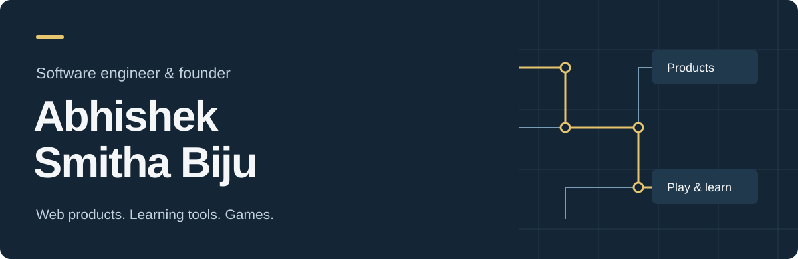

Third-year CS at **BITS Pilani, Goa** — builder first, student second. I founded [**Versor**](https://versor.in), a smart-menu platform running in five paying restaurants, and I'm currently a software engineer intern at **FourKites**, building the engine that turns recorded VirtuosoQA journeys into runnable Playwright tests. One standard for all of it: **if it isn't verified, it isn't done.**

### Now

- Migrating recorded end-to-end tests to **Playwright** at FourKites — 78 cases / 527 steps converted with none silently dropped
- Turning [**Versor**](https://versor.in) into a subscription SaaS for the Indian restaurant industry
- Practising C++ on **Codeforces** — data structures & dynamic programming

### Selected work

| Project | What it is | Built with |
| --- | --- | --- |
| [**versor.in**](https://versor.in) | One menu, everywhere — a restaurant edits a Google Sheet and the QR menu, website, Google listing & print PDF stay in sync | Next.js · Firebase |
| **Restaurant client fleet** | ~12 production builds that owners run end to end without a developer | Next.js · React · Vite |
| [**SpaceSaber**](https://github.com/abhishek-sbiju/SpaceSaber) | 2D space shooter — six enemy types, custom pathfinding, a soundtrack per level | Unity · C# |
| [**abhishek-sbiju.github.io**](https://abhishek-sbiju.github.io) | My portfolio — live Codeforces rating and GitHub stats, no stale numbers | React · Vite · Tailwind |

### Proof of work

> [!NOTE]
> Most of my work is client software in private repos (17 of them) — the [portfolio](https://abhishek-sbiju.github.io) has the full tour. Source available on request.

### Reach me

[**abhishekbijuw2005@gmail.com**](mailto:abhishekbijuw2005@gmail.com) · [Portfolio](https://abhishek-sbiju.github.io) · [LinkedIn](https://www.linkedin.com/in/abhishek-smitha-biju-7a739b321) · [Codeforces](https://codeforces.com/profile/Abhishek_S_Biju)

<code>designed & built by me · chennai & goa, india</code>

